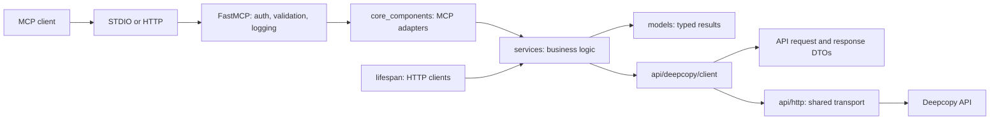

# Architecture

The template follows the service/adapter separation of `adk-template`, without
Google ADK or an LLM runtime.

`application.create_server(settings)` builds an independent server, registers
components explicitly, and installs the native logging middleware.

- **Adapters** define tool descriptions, argument schemas, annotations, and known errors.
- **Services** build request DTOs, call typed clients, and map responses to domain models.
- **API packages** own their clients, routes, settings, request DTOs, and response DTOs.
- **Shared transport** handles credentials, timeouts, bounded reads, and safe errors.
- **Models** define domain outputs independently of external response DTOs.
- **Lifespan** enters each API's client factory and closes all clients on shutdown,
  cancellation, or partial startup failure.
- **Settings** validate environment variables before startup.

HTTP is stateless. There is no shared business state or result cache between calls.
`Depends` injects services without exposing them in tool schemas.
JWTs identify callers; client-supplied IDs and metadata do not establish identity.

`MCP_RESOURCES_AS_TOOLS` and `MCP_PROMPTS_AS_TOOLS` enable compatibility for clients
that only support tools. Persistent sessions, interactive OAuth, background tasks,
and Code Mode are optional extensions, not included features.

Each upstream API is a package with `client/`, `config/`, and
`dtos/request/response/`. Here there is one: `api/deepcopy`, which reads the
Deepcopy API `/ibkr` routes.
