# Deepcopy architecture

Generated with the Desktop `generate-architecture` skill from source and Terraform
at commit `6e56f26`, on 2026-10-23. These views describe this checkout, not a live
deployment verification. They cover the public frontend, both analysis pipelines,
their read-only APIs, and shared inference infrastructure.

## System context



Visitors read market reports through the website. Authorized operators can submit
Momentum jobs, query its private consultation service, and administer LiteLLM.
The application depends on market-data providers, model providers and managed
PostgreSQL. Optional provider integrations are not evidence that credentials or
live connectivity are configured.

## Services and storage



- The Next.js server fetches the latest Scanner report with a Cloud Run identity
  token. The browser does not connect directly to the reader or database.
- Cloud Scheduler calls the Scanner service at 07:00 Europe/Paris. The service
  submits a Cloud Run Job and acknowledges submission without waiting for results.
  Its private ADK interface can also execute the shared workflow interactively.
- Momentum runs as a separate Cloud Run Job. Its request arrives in
  `TA_ANALYSIS_REQUEST`; this checkout does not implement a Momentum dispatcher.
- Both consultation APIs read persisted results with restricted database roles.
  The current frontend is wired to the Scanner reader, not the Momentum reader.
- Agent model calls use native Gemini transport through an internal-only Nginx
  route filter and LiteLLM sidecar, authenticated with virtual keys. Administration
  uses a separate IAP-protected service. Vertex AI is configured by Terraform;
  extra API-key providers and Redis/Valkey are optional.
- PostgreSQL has separate `market_scanner`, `momentum` and `litellm` databases.
  Scanner and Momentum separate `_analysis` from `_sessions`, with Liquibase
  managing domain schema changes. LiteLLM uses upstream Prisma migrations.

Secret Manager supplies runtime credentials; Artifact Registry and GitHub Actions
support builds and releases. These supporting resources and migration jobs are
omitted from the main runtime view for readability. Agent nodes are components
inside one job process, rather than independently deployed services.

## Market Scanner components



The workflow collects Yahoo Finance and US Treasury data, computes trends locally,
then runs researcher, critic and synthesizer agents. Research tools fetch news,
optional FRED macro indicators and Polymarket data; Google Search is passed as a
model tool through the inference gateway. Enrichment and assembly produce a typed
report before a transaction writes the report, assets and horizons. ADK session
events are stored independently. The daily job requires persistence to be configured.

## Momentum components



The runner starts or resumes an ADK invocation. Selected analyst branches run in
parallel after any pending memory reflections; each analyst has a data collector
and typed formatter. Bounded bull/bear research precedes the trader proposal,
three-perspective risk debate, portfolio decision and final result construction.
The next review date is generated, not automatically scheduled by this job.

Before model execution, the job admits the request and prepares context from
PostgreSQL, resolving pending market outcomes where data is available. The job
orchestrator then commits all result sections with their session and invocation
IDs and records memory completion in the same transaction. Arrows show execution/data flow,
not a claim that every component directly calls its successor. All model calls
use the private inference gateway (shown in the services view; repeated edges are
omitted here). Yahoo is the default data vendor; Alpha Vantage adapters also exist.

Trading memory is active in the job runner and uses the Momentum PostgreSQL
database. Admission happens before model execution; the memory repository reads
past context and pending outcomes before the graph runs. Result sections and
memory reflections are committed atomically after successful execution. ADK
session events remain a separate persistence path.

## Boundaries and documentation differences

| Existing documentation or integration | Current code evidence and treatment |
| --- | --- |
| README platform vision includes public MCP, an internal MCP layer and IBKR order execution. | This checkout contains MCP references and frontend links, but no implementations of those services or broker execution. They are excluded from current runtime views; this does not assert they do not exist elsewhere. |
| Existing implementation diagrams focus on Scanner. | The new model also includes the Momentum job and its separate read-only API. |
| `infra/README.md` lists infrastructure roots but omits `infra/momentum-api`. | That root exists and provisions the Momentum consultation service; it is included here. |
| A Momentum tool can request the latest Scanner report. | `TA_MARKET_SCANNER_API_URL` is optional and not wired by the Momentum Terraform root; the tool does not attach a Cloud Run identity token. No active job-to-reader connection is asserted in these views. |
| Momentum previously used a local Markdown memory log. | Commit `76ecf7c` wires `PostgresMemoryRepository` into `job_runner.py` and removes the local log. The diagram follows the current source path; deployment is not independently attested. |

## Source evidence

Paths below are relative to the repository root. This list supports the principal
relationships in the model; it does not substitute for runtime validation.

| Concern | Authoritative source |
| --- | --- |
| Frontend server-to-reader wiring | `apps/frontend/src/lib/market-scanner/reader.ts`, `latest-scan.ts`; `infra/frontend/main.tf` |
| Scanner schedule and dispatch | `infra/market-scanner/market_scanner_schedule.tf`, `market_scanner_job.tf`; `apps/backend/market-scanner-adk/src/app/application.py`, `services/scan_dispatch.py` |
| Scanner graph and result write | `apps/backend/market-scanner-adk/src/app/components/agents/market_scanner/agent.py`, `jobs/daily_scan.py`, `services/market_scan_persistence.py` |
| Scanner public-data integrations | `apps/backend/market-scanner-adk/src/app/client/market_research_client.py`, `treasury_client.py`, `yahoo_finance_client.py` |
| Momentum request and persistence | `apps/backend/momentum-adk/app/job_runner.py`, `services/runtime.py`, `services/execution.py`, `infrastructure/result_repository.py`; `infra/momentum/main.tf` |
| Momentum graph | `apps/backend/momentum-adk/app/components/agents/momentum/workflow/factory.py`, `analysts.py`, `debates.py`, `nodes.py`, `results.py`; `components/agents/momentum/catalog.py` |
| Scanner tool and Momentum memory path | `apps/backend/momentum-adk/app/components/tools/market_data.py`, `app/job_runner.py`, `app/services/memory.py`, `app/infrastructure/memory/postgres.py` |
| Momentum admission and durable result/memory transaction | `apps/backend/momentum-adk/app/infrastructure/admission.py`, `app/infrastructure/result_repository.py`, `database/domains/momentum/migrations/001-trading-memory.sql` |
| Reader services | `apps/backend/market-scanner-api/src/app/routes/market_scans.py`; `apps/backend/momentum-api/src/app/presentation/routes/analyses.py`; `infra/reader/main.tf`, `infra/momentum-api/main.tf` |
| Inference routing and administration | Both applications' `config/llm.py`; `infra/litellm/gateway.tf`, `service.tf`, `foundation.tf`, `providers.tf`, `redis.tf` |
| Domain databases and roles | `database/domains.json`, `database/domains/market_scanner/`, `database/domains/momentum/`, `database/domains/litellm/README.md` |

## Regeneration

Edit [workspace.dsl](architecture/workspace.dsl), then run:

```sh
cd docs/explanation/architecture
just validate
just export-mermaid
```

The [Justfile](architecture/Justfile) pins the locally verified Structurizr image
(2026.05.22) by digest. The skill's old `structurizr/cli:latest` image only prints a
retirement notice and exits successfully without validating or exporting; the
recipe was corrected to use the consolidated tool. Mermaid CLI 11.15.0 renders
the four exports using [mermaid-config.json](architecture/mermaid-config.json).
No network rendering service is used. `just explore` opens a local Structurizr UI.

SVGs use Mermaid HTML labels: open them in a modern browser for faithful rendering.

## References

- [Editable architecture model](architecture/workspace.dsl)
- [Project README](../../README.md)
- [Infrastructure guide](../../infra/README.md)
- [Database guide](../../database/README.md)
